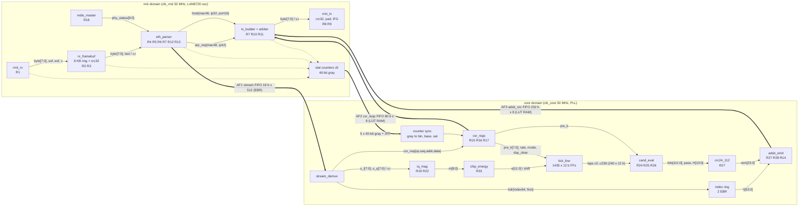
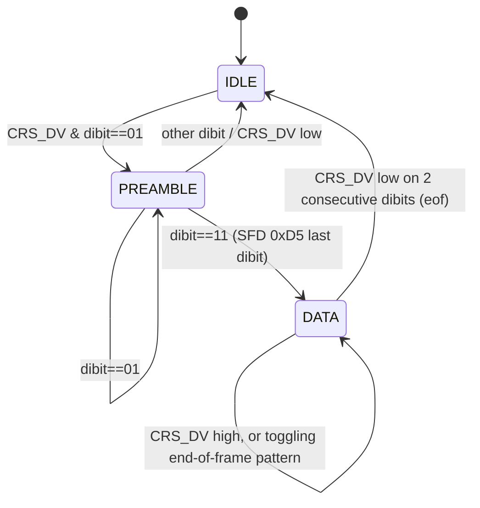

# sdr_ulx3s — microarchitecture

Bridge between [spec.md](spec.md) (v0.4) and the RTL. Every structure cites the requirement it serves. Written before RTL; update it whenever the structure changes.

**Central idea: the tick delay line.** The ADS-B decoder never searches or queues. Each new sample produces $S$ chip energies $e(t)$, one per tick $t$ of $\tfrac{1}{12}$ µs ($S = 5$ at 2.4 MS/s, $S = 6$ at 2.0 MS/s). These are shifted into a 1,435-entry delay line, one tick per clock. After every shift, the oldest tick $T$ is a complete candidate. Its 240 chip energies sit at fixed taps 6 apart ($c_j = e(T + 6j)$, R33), so the preamble test, 112 bit decisions and CRC run on fixed wiring with no multiplexers, one candidate per cycle, in increasing $T$. This gives R23 (every candidate tested), R28 (strict order) and R20 (one sample per $S \le 6$ cycles) by construction.

**Built so far** (cocotb vs `tb/adsb_ref.py` + SymbiYosys): `iq_mag` (A1/A2, all 65,536 inputs), `chip_energy` (B, both rates, k-induction proof), `adsb_emit` (G, records byte-identical to the model on 3 streams incl. every outcome; P6, sequence numbers and R34 proved for all time by k-induction; synth_ecp5: 155 LUT4 + 116 CCU2C, 722 FF), `cand_eval` (D1–F, 3,500+ candidates checked incl. every R24 relation as first failure; outputs proved for every input except the `*` primitive; synth_ecp5: 1,053 LUT4 + 827 CCU2C, 939 FF, 1 MULT18X18D), `crc24_112` (F2 CRC, all 112 columns and 9,000 words checked; P1 proved by linearity over $\mathrm{GF}(2)$; synth_ecp5: 368 LUT4 + 55 PFUMX, 25 FF), `tick_line` (C, every candidate's 240 taps checked; formal on a 19-entry line; synth_ecp5: 17,244 FF, 41 LUT4 + 16 CCU2C, no RAM inferred).

A behavioral prototype of exactly this structure ([scripts/tickline_proto.py](../scripts/tickline_proto.py)) (insertion rule, fixed taps, fill counter, header-derived T) produced the same records and `ADSB_CAND` as `tb/adsb_ref.py` in every case tried:
- random streams at both rates and at 20 dB and 10 dB;
- a 777-sample sequence gap;
- every boundary case;
- frames ending exactly at the end of a segment, at all 12 tick offsets.

## 1. Block diagram



Top level `sdr_top`: `ecp5pll` (25 → 50 MHz, lock), two `rst_sync`, LED drivers (R30), MDIO tri-state buffer.

## 2. Pipelines

### 2a. ADS-B DSP (`core`), one tick per cycle

The front end accepts a sample every $S$ cycles. Every cycle that has a tick to shift advances the candidate pipeline by one. Throughput: 2.4 MS/s mode → 5 cycles per sample (10 MS/s capacity); 2.0 MS/s mode → 6 cycles (8.3 MS/s). Both exceed R20's 6.25 MS/s.

| Stage | Computes | Registers at end | Logic depth (est.) | Req |
|-------|----------|------------------|--------------------|-----|
| A1 | pop sample; $\lvert x \rvert = \lvert 2u - 255 \rvert = 2h + 1$ with $h$ = `u[6:0] ^ {7{~u[7]}}`: odd, so only the top 7 bits $h$ are stored | `h_i[6:0]`, `h_q[6:0]` | 1 LUT (XOR), no carry chain | R19 |
| A2 | $m = (2h_{\max} + 1) + h_{\min}$, which equals $\max + \lfloor \min / 2 \rfloor$ because both $\lvert x \rvert$ are odd | `m[8:0]` | compare 7 b + add 9 b | R22 |
| B | on accepting $m[k]$: $m_{\text{prev}} \leftarrow m$, $m \leftarrow m[k]$; then for tick $i = 0, \ldots, S - 1$ of the batch (one per cycle): $e = (5 - i)\,m_{\text{prev}} + (1 + i)\,m$ (shift-add, no multiplier). The same formula holds at both rates: at 2.0 MS/s, $i = 5$ gives $0 \cdot m_{\text{prev}} + 6m$ | `e[11:0]`, `m_prev`, `m`, `i` | 3:1 shift-add, 12 b | R33 |
| C | shift $e$ into `tick_line` (CE; entry 0 = oldest tick $T$, tap $c_j$ = entry $6j$); fill counter $0, \ldots, 1440$ ($\mathrm{THR} = \mathrm{LINE} + 5$, so valid $\Leftrightarrow T \ge 0$); head $\varphi = T \bmod S$ and $p = \lfloor T / S \rfloor \bmod 512$; `out_valid` one cycle after a shift that completes a candidate of the phase set | `line[1434:0]`, `fill[10:0]`, `phi[2:0]`, `p[8:0]`, `out_valid` | 11 b compare (fill) | R23 R32 |
| D1 | taps → 10 shape compares; 112 bit compares $c_{16+2i} > c_{17+2i}$; pairwise sums for $H$, $L$; issue index-ring read for head sample | `shape_ok`, `bits[111:0]`, partial sums, $c_{11}, \ldots, c_{14}$ | 12 b compare carry chains | R24 R26 |
| D2 | $H$ = sum of the 4 pulse chips, $L$ = sum of the 6 gap chips; $\mathrm{DF}$ = `bits[111:107]` $\in \{17, 18\}$ | `H[13:0]`, `L[13:0]`, `df_ok` | 14 b adder | R25 R27 |
| E1 | $K \cdot L$ in MULT18X18D (input reg); $6H = 4H + 2H$ (two shifts); $4 c_k < H$ for $k = 11, \ldots, 14$; operands $K$ and $L$ registered for the multiplier | `e1_k`, `e1_l`, `e1_6h[15:0]`, `e1_quiet` | 14 b compares | R25 |
| E2 | $K \cdot L$ product out of MULT | `e2_kl[21:0]` | MULT output reg | R25 |
| F | $\text{level\_ok} = (6H \ge K L)$; $\text{cand} = \text{shape\_ok} \land \text{level\_ok} \land \text{quiet\_ok}$ (`tick_line` only presents candidates of the phase set, so no phase check is needed here); `cand` increments `ADSB_CAND` | `out_cand`, `out_df_ok`, `out_bits`, `out_h` | 22 b compare | R25 R27 |
| F2 | CRC-24 of `out_bits` in `crc24_112`: XOR of the constant columns $x^i \bmod G(x)$ for the set bits (table generated by `scripts/gen_crc24_table.py`) | `rem[23:0]` | ~6 LUT levels | R27 P1 |
| G1 | `adsb_emit`: candidate registered; the two late inputs arrive in this cycle: `rem` from `crc24_112` (fed by `cand_eval.out_bits`) and $n$ from the index ring (read address `cand_eval.out_p`, synchronous read); `cand_inc` pulse for `ADSB_CAND` | `g1_*` | — | R25 |
| G2 | $\text{ok} = \text{cand} \land \text{df\_ok} \land (\text{rem} = 0)$; $T = S n + \varphi$ with $Sn = 4n + n$ or $4n + 2n$ | `g2_ok`, `g2_t[66:0]` | 67 b adder | R27 R14 |
| G3 | $\text{emit} = \text{ok} \land (\lnot\text{have} \lor T \ge \text{lim})$; on emit: $\text{lim} \leftarrow T + 1440$, $\text{seq} \leftarrow \text{seq} + 1$; record registered; `out_push` = record $\land \lnot$ `af3_full`, `out_drop` = record $\land$ `af3_full` (R34); `clear` resets `have` only | `have_q`, `lim_q[67:0]`, `seq_q[31:0]`, record | 68 b compare | R28 R34 |

Pipeline latency: $2 + 1 + 1 + 5 + 3$ (stages A, B, C, D1–F and G1–G3; F2, the CRC, runs alongside G1) = **12 cycles = 0.24 µs** from accepting the final sample to the record push, plus up to $S - 1$ cycles while that sample's ticks drain. The spec sets no cycle latency; the end-to-end budget is R29 (section 2c).

**Insertion rule.** When sample $k$ of the current segment arrives, ticks $t = Sk - 5, \ldots, Sk - 5 + S - 1$ are inserted:
- 2.4 MS/s: the 5 ticks of sample $k - 1$.
- 2.0 MS/s: ticks 1–5 of sample $k - 1$ and tick 0 of sample $k$.

Every inserted tick's chip touches only $m_{\text{prev}}$ and $m$. After each shift, the candidate start is $T = t_{\text{newest}} - 1{,}434$, so a candidate becomes ready on exactly the sample the model requires (A3). This is verified by the prototype.

**Validity.**
- The fill counter starts at $-5$ because the first batch of a segment contains 5 ticks before $t = 0$. It saturates at 1,435, and a candidate is valid only once it is saturated.
- `phase_ok` is always 1 at 2.4 MS/s; at 2.0 MS/s it is 1 only when $s_{\text{head}} = 0$ (R32).
- `dsp_clear` (R17, or a new-stream flag) resets the fill counter, `s_head`, the head pointer and the "no prior emit" flag. The 17 k line flops are not cleared; they are invalid until refilled.

**T for R28 and the record.**
- $n$ is the head sample's header-derived index, read from the index ring (A1). $\varphi = s_{\text{head}}$.
- Suppression compares $T_{\text{hdr}} = S n + \varphi$, not a received-tick count, so a sequence gap behaves as in the model.
- Ordering: the model sorts candidates by T and the RTL uses arrival order. These always agree, because R13 (b) makes header indices strictly increase within a stream: an index that goes backwards starts a new stream, which clears the DSP state.

### 2b. Ethernet (`rmii`), one dibit per cycle

| Path | Stages | Notes |
|------|--------|-------|
| RX | dibit sample on CRS_DV → byte assembly (4 cycles/byte) → CRC-32 (8-bit parallel, 1 cycle/byte) → ring write | FCS by residue check (0xC704DD7B). Length counted 64–1518 (R1, R2). |
| Framebuf → parser | frame descriptor FIFO (start, length) → parser reads 1 byte/cycle | parser runs $4\times$ faster than line rate |
| TX | arbiter picks job → builder emits bytes on request → rmii_tx: preamble/SFD, dibits, pad to 60, append FCS, IFG $\ge 48$ cycles | IPv4 checksum summed during the 32-cycle preamble (R10) |

### 2c. R29 end-to-end latency budget (worst case, 2.0 MS/s mode, $N = 700$)

| Step | Time |
|------|------|
| Frame already complete in ring at its last FCS dibit (R3); parser reaches first sample (58 header bytes) | 1.2 µs |
| Stream FIFO CDC (gray pointer sync) | 0.1 µs |
| DSP consumes up to 700 samples at 6 cycles each (no backlog from the previous packet: at line rate it finishes 50+ µs before the next arrives) | 84.0 µs |
| Pipeline + AF3 CDC | 0.3 µs |
| TX: wait for the frame in progress ($\le 98$ B on the wire) + one ARP reply + one CSR response ahead (R11) | $7.8 + 6.7 + 6.7$ µs |
| **Total** | **$\approx 107$ µs $\le 120$ µs** |

At 2.4 MS/s (5 cycles/sample) the total is $\approx 93$ µs, and with the default 512 pairs $\approx 74$ µs. The tightest case (2.0 MS/s, 700 pairs) leaves 13 µs of margin. If it is exceeded, the fix is a dedicated 4-cycle-per-sample mode, which only needs the batch shifts to overlap with the next sample's A stages.

## 3. Datapath widths

| Bus | Width | Why |
|-----|-------|-----|
| $u_I$, $u_Q$ | 8 | rtl_sdr bytes |
| $\lvert x \rvert$ | $8 + 1$ | $\le 255$ |
| $m$ | 9 | $\le 382$ (R22); reachable values $1, 3, \ldots, 382$ |
| $e$, $c_j$ | 12 | $\le 6 \times 382 = 2{,}292$ (R33) |
| $H$, $L$ | 14 | $H \le 9{,}168$, $L \le 13{,}752$ (R25) |
| $6H$ | 16 | $\le 55{,}008$ |
| $K$ (`pre_k`) | 8 | bits [7:0] (spec, assumed width) |
| $K \cdot L$ | 22 | $\le 255 \times 13{,}752 = 3{,}506{,}760$ |
| bits | 112 | R26 |
| CRC remainder | 24 | R27, P1 |
| $n$ (sample index) | 64 | I/Q header field |
| $T$; suppression limit $T + 1440$ | 67; 68 | $S n + \varphi \le 6(2^{64} - 1) + 4 < 2^{67}$, and $T + 1440 < 2^{68}$: exact for every 64-bit index |
| stream FIFO word | 18 | tag[1:0] + 16 data (see 6) |
| csr_resp | 80 | op implied; seq 32 + addr 16 + data 32 |
| adsb_rec | 232 | seq 32, $n$ 64, $\varphi$ 3, rate 1, df18 1, H 16, frame 112, pad 3 |
| rec_seq | 32 | +1 per emitted record, including records later dropped (record format, R34) |
| expected index (parser, rmii) | 64 | previous accepted I/Q packet's index + N, for R13 (b) |
| stat counters | 40 | gray-crossed, free-running; see 5 |
| CSR registers | 32 | spec |

All widths are exact upper bounds from the reference model's exactness argument; nothing saturates or wraps except the counters (R16).

## 4. FSMs

Every FSM: binary encoding (Yosys may re-encode to one-hot via `fsm`), synchronous reset to the first state listed, and a `default:` arm that returns to that reset state. All unused codes therefore recover within one cycle. Each FSM gets a SymbiYosys cover for every state and an assertion that the state is never an unused code.

### rmii_rx (R1)

CRS_DV toggles at the end of a frame while the PHY's FIFO drains (RMII 1.2 §5.3.2). Data stays valid until CRS_DV is low for a whole byte-aligned dibit pair. A frame ending mid-byte is flagged as an error and counted in `RX_BAD` (R2).

### rx_framebuf (R2, R3)
`IDLE → WRITE → (CHECK) → IDLE`. While writing, the head pointer is tentative. At eof:
- if the FCS residue is correct, the length is 64–1518 and the ring did not overflow: push a descriptor and commit;
- otherwise roll back to the committed pointer and pulse `rx_bad`.

`rx_frames` pulses on commit.

### eth_parser (R4–R7, R12, R13)
```mermaid
stateDiagram-v2
  [*] --> IDLE
  IDLE --> ETH: descriptor available
  ETH --> SKIP: dst MAC not ours/broadcast (R4), or unknown ethertype
  ETH --> ARP: 0x0806
  ETH --> IP: 0x0800
  ARP --> SKIP: done (latch reply job if opcode 1 & target IP ours, R6)
  IP --> SKIP: version/IHL/frag/checksum/dst/proto fail (R5)
  IP --> UDP: ok
  UDP --> SKIP: port not 5000/5005
  UDP --> IQHDR: 5000
  UDP --> CSRBODY: 5005
  IQHDR --> SKIP: magic/version/length bad (R12, rx_badpkt)
  IQHDR --> IQDATA: ok (R13: (a) sequence and (b) index vs the previous packet that passed R12, whatever MODE; new-stream bit = flag bit 0 or (b); push HDR tokens; learn host R7)
  IQDATA --> SKIP: last sample pushed
  CSRBODY --> SKIP: done (bad → rx_badpkt; ok → push CSR tokens, learn host)
  SKIP --> IDLE: frame fully read (padding ignored)
```
The parser is byte-counter driven: each state compares the byte offset against constants. Every check finishes before the first payload byte is forwarded, so no partial effect is possible (R3). The FCS is already known good.

### tx_builder / arbiter (R8–R11)
`IDLE → (pick ARP > CSR > ADSB, R11) → HOSTCHK → SEND → WAIT_DONE → IDLE`.
- HOSTCHK: if no host has been learned (R7), drop the CSR or ADS-B job and pulse `tx_nohost`. ARP replies go to the requester and need no learned host.
- The job is snapshotted at the start of SEND, so a newer ARP or a learned-host change can't alter a frame in flight (R11).

### rmii_tx (R8, R9)
`IDLE → PREAMBLE(7×55, D5) → DATA → PAD(to 60) → FCS(4) → IFG(48 cycles) → IDLE`. TX_EN is high from PREAMBLE through FCS (P5).

### csr_regs (R15–R17)
`IDLE → WAIT_DRAIN → EXEC → RESP → IDLE`.
- WAIT_DRAIN holds every CSR request until the DSP pipeline is empty (no ticks pending, stages D1–G invalid). Every request therefore takes effect after every earlier sample has been fully evaluated, and before any later one: writes to MODE, PRE_K or ADSB_RATE never mix two configurations, and reads of `ADSB_CAND` and `ADSB_FRAMES` match `SystemModel` (R17, R21).
- RESP never waits: if AF2 is full, the response is dropped and `TX_DROP` increments (R34). A write has already taken effect by then (R15).

### mdio_master (R18)
`RESET_WAIT(>= 1 ms) → SCAN(addr 0..31, read reg 2 == 0x0007) → POLL_WAIT(100 ms) → READ_BSR(reg 1) → READ_SCSR(reg 31) → PUSH → POLL_WAIT`. If no PHY is found, PUSH sends found = 0 and the scan repeats every 100 ms. MDC = 50 MHz / 32 = 1.5625 MHz ($\le 2.5$ MHz). The MDIO bit engine is a separate 6-bit counter FSM (preamble $32 \times 1$, ST, OP, PHYAD, REGAD, TA, 16 data).

## 5. Clocks, resets, crossings

| Domain | Clock | Freq | Reset |
|--------|-------|------|-------|
| core | `clk_core`, EHXPLLL from `clk_25mhz` | 50 MHz | `rst_sync` with async assert (PLL unlocked or btn[0] pressed) and 2-flop synchronous de-assert; flops INIT = 1 |
| rmii | `clk_rmii`, gn12 → global buffer | 50 MHz | same sources, own `rst_sync`, INIT = 1 so the domain stays in reset until its clock has run 2 edges (module unplugged → rmii held in reset, core unaffected) |

| # | Signal | Width | From → to | Mechanism | Why safe |
|---|--------|-------|-----------|-----------|----------|
| AF1 | stream FIFO: samples, I/Q headers, CSR requests, PHY status | $18\text{ b} \times 512$ | rmii → core | async FIFO, EBR, gray pointers + 2FF | spec row (v0.4): one FIFO, so samples, headers and CSR requests reach the core in arrival order, which R17 and R21 need (see 6). |
| AF2 | CSR responses | $80\text{ b} \times 8$ | core → rmii | async FIFO, LUT RAM, gray pointers | spec row |
| AF3 | ADS-B records | $232\text{ b} \times 8$ | core → rmii | async FIFO, LUT RAM, gray pointers | spec row |
| G1–G5 | RX_FRAMES, RX_BAD, RX_BADPKT, RX_SEQGAP, TX_NOHOST | 40 b each | rmii → core | binary counter → gray register → 2FF → gray-to-binary | $+1$ at most per rmii cycle, so one gray bit changes at a time. `domains.py` will flag these as MULTI-BIT; this row is the justification. |
| R1 | PLL lock, btn[0] | 1 | async → both | `rst_sync` | async assert, sync de-assert |
| — | link up, PHY ready | — | — | not crossed as single bits | PHY_STATUS goes through AF1 as a token. led[3] is driven inside rmii. The spec's 2FF row is unused. |
| — | learned host MAC/IP/port | — | rmii only | not crossed | spec |

**CTRL clear without a core → rmii crossing (R16).** The 40-bit gray counters in rmii run freely and are never cleared. On a `CTRL` write, the core snapshots each synchronized value as a base. A register read returns $\min(\text{current} - \text{base},\ 2^{32} - 1)$, so it reads 0 after a clear, saturates (R16) and never decreases (P8). It only goes wrong after $2^{40}$ events, which takes 85 days of nonstop minimum-size frames at line rate. led[7] lights when any of those three differences is non-zero.

LEDs (R30): led[0], led[5], led[6], led[7] are driven from core; led[1], led[3], led[4] from rmii; led[2] directly from PLL lock. They are output pins only, so no crossing.

## 6. Interfaces between blocks

Convention, unless noted: valid/ready. Data must stay stable while `valid & !ready`; a transfer happens on a cycle with `valid & ready`; once raised, valid stays up until the transfer.

| Interface | Protocol | Who stalls |
|-----------|----------|------------|
| rmii_rx → rx_framebuf | valid-only, one byte per 4 cycles, `sof`/`eof`/`err` | nobody. The ring never stalls the PHY: on overflow, the frame is dropped whole and counted in RX_BAD (R2). |
| rx_framebuf → eth_parser | valid/ready, `last` on the final byte | parser |
| eth_parser → AF1 | valid/ready (`!full`) | AF1 full stalls the parser; the 8 KB ring absorbs the backlog |
| AF1 → stream_demux | valid/ready (`!empty`) | demux stalls while the DSP or CSR target isn't ready, or during WAIT_DRAIN |
| demux → iq_mag | valid-only, 2-cycle pipeline (no stall inside) | demux: issues a sample at most once per $S$ cycles, so it reaches chip_energy exactly when `in_ready` is high again |
| iq_mag → chip_energy | valid/ready; `in_ready` is low while ticks of the current batch remain ($S$ cycles per sample) and during reset/`clear`. A sample offered while not ready is a protocol error (formal assumption) | chip_energy |
| chip_energy → tick_line | valid-only shift strobe `out_valid` + `out_e`; `idle` (no batch in flight) feeds WAIT_DRAIN | nobody |
| tick_line → cand_eval | valid-only: `out_valid` for one cycle per candidate; `out_taps` ($240 \times 12$ b, $c_0$ in the low bits), `out_phi`, `out_p` (index-ring address) are stable only in that cycle, because the next shift may follow at once, so D1 must register what it needs | nobody |
| cand_eval → crc24_112, adsb_emit | valid-only, 5-cycle fixed latency; `out_cand`, `out_df_ok`, `out_bits`, `out_h`, `out_phi`, `out_p` stable only in the `out_valid` cycle; `idle` (nothing in flight) feeds WAIT_DRAIN | nobody |
| crc24_112, index ring → adsb_emit | the late inputs: `in_rem` and `in_n` belong to the candidate presented one cycle earlier | nobody |
| adsb_emit → AF3 | valid-only, one 232 b word per record | nobody: if AF3 is full the record is dropped and `TX_DROP` increments (R34); its sequence number is still consumed |
| csr_regs → AF2 | valid-only, checked against `full` | nobody: if AF2 is full the response is dropped and `TX_DROP` increments (R34), so AF1 never stalls on TX |
| AF2 / AF3 / ARP job → arbiter | valid/ready, popped when SEND starts | arbiter |
| tx_builder → rmii_tx | byte request/ack, one byte per 4 cycles | rmii_tx paces; the builder must answer in $< 4$ cycles |

**AF1 word format** (tag[17:16]):

| Tag | Name | Contents |
|-----|------|----------|
| 00 | SAMPLE | data = {I, Q} |
| 01 | HDR | 5 words: flags (bit 0 = new stream), then index[63:48], ..., [15:0] |
| 10 | CSR | 6 words: op, seq hi, seq lo, addr, data hi, data lo |
| 11 | PHYSTAT | 1 word: status[9:0] |

The demux handles each tag as follows:
- SAMPLE: discarded while `MODE` $\ne 1$.
- HDR: loads the index counter that is written into the index ring alongside each sample. If the new-stream bit is set (flag bit 0, or R13 (b) detected by the parser), it first waits for the DSP to drain, then pulses `dsp_clear`.
- CSR: goes to `csr_regs`.
- PHYSTAT: updates the shadow `PHY_STATUS` register.

## 7. Resource estimate vs budget

| Item | LUT4 | FF | EBR | MULT18 |
|------|------|----|-----|--------|
| tick_line | ~0 (CE flops) | 17,220 | | |
| cand_eval (measured; 122 compares on carry chains, 112 bits carried through 4 stages) | 1,053 + 827 CCU2C | 939 | | 1 |
| crc24_112 (measured) | 368 + 55 PFUMX | 25 | | |
| adsb_emit (measured; 67 b adder, 68 b compare, record registers) + index ring (est.) | 155 + 116 CCU2C | 722 | 2 | |
| iq_mag, chip_energy | ~120 | ~60 | | |
| csr_regs + counter sync/base/sat ($5 \times 40$ b) | ~1,300 | ~700 | | |
| Ethernet: rmii_rx/tx, $2\times$ crc32, framebuf, parser, builder, mdio, counters | ~3,500 | ~1,500 | 4 | |
| AF1–AF3 | ~500 | ~300 | 1 | |
| **Total (est.)** | **~8,100 (T2: $\le 20{,}000$)** | **~20,900 of 83,640 (25 %)** | **7 of 208, 3 % (T4: $\le 30$ %)** | **1 (T3: $\le 8$)** |

## 8. Risks

| # | Risk | Plan if it bites |
|---|------|------------------|
| 1 | **Fmax: the 17 k-flop CE net** has very high fanout | Replicate the CE register $16\times$ (one per 90-tap group) with `keep`. If still slow, run the line without CE: shift every cycle, insert a "bubble" tick with a valid bit, and gate evaluation on that valid bit (each line entry gains 1 bit). |
| 2 | **Fmax: rmii clock on gn12** may not be a dedicated clock input (spec open question) | nextpnr will route it to a global buffer through general fabric, adding skew. Check the `rmii` timing report at Step 0; if it fails, constrain with `FREQUENCY PORT` and consider rewiring to a GPLL-capable pin. |
| 3 | **Area: tick_line flops** (17 k) dominate FF use | Fallback: keep only a $289 \times 9$ b magnitude buffer (2.6 k FF) and compute the 240 chip energies per phase with 5:1 weight muxes ($\approx 7$ k LUT4). Still within T2. |
| 4 | **AF2/AF3 overflow under an ARP/CSR flood.** Records drain at $\ge 1$ per 7.8 µs against $\le 1$ emitted per 28.8 µs, but a hostile stream of ARP or CSR requests at line rate takes all of TX through priority (R11) | Depth 8 each covers normal use. On overflow the record or response is dropped and counted in `TX_DROP` (R34); record sequence numbers show the gap to the host. Neither the DSP nor the CSR block ever stalls, so P4 and R20 hold. |
| 5 | **R29 margin** is only 13 µs at 2.0 MS/s with 700-pair packets | Measured in system simulation. Fallback: 4-cycle sample acceptance (section 2c). |
| 6 | **Verification: R21 needs deterministic ordering** of config writes against samples | Solved by the shared AF1 plus WAIT_DRAIN. The system test must include a CSR write between two packets of one stream and compare against `SystemModel`. |
| 7 | **Verification: tick_line is too big for formal** | Prove P4 and P6 on a parameterized small line (e.g. a 15-chip frame variant). P1 is proved on `crc24_112` standalone, through linearity: both the RTL and the bit-serial definition are linear over $\mathrm{GF}(2)$, so checking the 112 basis vectors $x^i$ and zero proves them equal (a direct check over all inputs stalls every solver). Cover the full design by simulation against the model. |
| 8 | **CRS_DV end-of-frame toggling** differs between PHY datasheets | Block test with both clean and toggling CRS_DV endings; Step 1 hardware check with pings of every size. |

## 9. Spec questions (settled in spec v0.4)

| Q | Settled as | Where |
|---|---|---|
| Q1 index goes backwards | An index lower than the previous packet's index + N starts a new stream and increments `RX_SEQGAP`. Detected in `eth_parser`, carried in the HDR token's new-stream bit. | R13 (b), R17 |
| Q2 output queue overflow | Drop and count in `TX_DROP` (0x44); `csr_regs` and `adsb_emit` never stall on AF2/AF3. Record sequence numbers are assigned in `adsb_emit`, so drops are visible to the host. | R34, R15, record format |
| Q3 RX ring overflow | Frame dropped whole, counted in `RX_BAD`; cannot happen at or below line rate because the parser drains at $4\times$ line rate and the DSP at $1.4\times$ (2.0 MS/s mode) to $1.7\times$ (2.4 MS/s mode). | R2 |
| Q4 PHY_STATUS crossing | Carried through the single rmii → core FIFO (AF1) with samples and CSR requests. | crossing table |
| Q5 counter lifetime | Correct for $2^{40}$ events after reset ($\ge 85$ days at the worst-case rate). | R16, P8 |

Also settled in v0.4: every CSR request (not just configuration writes) is ordered with the samples (WAIT_DRAIN), R21 covers ADS-B records and `ADSB_CAND`/`ADSB_FRAMES` reads but not the Ethernet counters, and `MODE` reads back all 32 bits as written.

## 10. CDC check

`domains.py` has not been run: there is no RTL yet. Once `sdr_top` exists, run:

```sh
python3 ~/.claude/skills/microarch/domains.py --top sdr_top -I rtl rtl/*.v rtl/*/*.v --strict
```

Expected:
- **UNSAFE: 0.**
- **MULTI-BIT:** only the gray pointers of AF1–AF3 and the five gray counters G1–G5, all justified in section 5.
- **Latches: 0.**
